# AgencyBD Enterprise: The Autonomous Agency Platform
## Complete User Guide, Architecture Blueprints & Visual Operational Manual

---

## 1. Executive Summary & The Autonomous Operating Paradigm

**AgencyBD Enterprise** is an autonomous, sovereign Business Development (BD) platform built specifically for software engineering studios, AI agencies, and digital product consultancies. 

### Why Autonomous?
Traditional outbound BD requires 4 to 6 separate subscription tools costing \$1,500+/month (Apollo/Clay for sourcing, PageSpeed/Ahrefs for audits, Lavender for copy scoring, Tavus/Loom for video teardowns, and HubSpot for pipeline CRM) plus hours of manual context-switching.

AgencyBD replaces this fragmented stack with **100% sovereign, self-driving multi-agent automation**:
1. **Zero Recurring Cost**: \$0 monthly SaaS fees, running completely on local SQLite, native Python 3.13, and free public data sources (SEC EDGAR, OpenStreetMap, Hacker News, RemoteOK, GitHub Bounties, and EU/US Public Tenders).
2. **One-Click Autonomous Execution**: A single click coordinates 4 specialist agents:
   - **Sourcing Scout**: Identifies funded companies or businesses with digital presence gaps.
   - **Forensics Engineer**: Performs instant headless Core Web Vitals (LCP, TTFB, SSL, SEO) audits.
   - **Deal Strategist**: Calculates mathematical win probabilities ($P(\text{Close})$) and drafts custom proposals citing verified case studies verbatim.
   - **Deliverability Sentinel**: Validates email permalink syntax and verifies MX handshakes without external credits.
3. **Single Unified Link**: Both frontend and backend run seamlessly together on:
   $$\mathbf{http://localhost:8001}$$

---

## 2. Platform Architecture & Data Flow

```mermaid
flowchart TD
    subgraph SOURCING ["1. Autonomous Discovery & Ingestion"]
        S1["SEC EDGAR Form D (Venture Startups)"]
        S2["OpenStreetMap (Local High-Ticket Clinics & Firms)"]
        S3["Opportunity Radar (Upwork, GitHub Bounties, EU/US Tenders)"]
        S4["Hacker News & RemoteOK (Active Hiring Pain)"]
    end

    subgraph FORENSICS ["2. Technical Forensics & Audit"]
        F1["Core Web Vitals Engine (LCP, TTFB, CLS)"]
        F2["Security & SSL Diagnostic (TLS, Security Headers, DMARC)"]
        F3["Tech Stack Fingerprint (React, Next.js, CloudFront, WordPress)"]
        F4["Presence Rescue Probe (No site, dead domain, social only)"]
    end

    subgraph SYNTHESIS ["3. Proposal & Video Storyboard Studio"]
        P1["4-Scene Founder Video Storyboard (Tavus/Loom Replacement)"]
        P2["Lavender 90+ Cold Outreach Copy & Spam Filter"]
        P3["Verifiable Statement of Work (SOW) Generator"]
    end

    subgraph DISPATCH ["4. Deliverability Fleet & Compliance"]
        D1["Multi-Mailbox ESP Routing & Spintax Syntax"]
        D2["CAN-SPAM HMAC Suppression Vault (Cryptographic Opt-Out)"]
        D3["Multi-Step Outbound Cadence (Day 1, 3, 7, 14 auto-pause on reply)"]
    end

    subgraph REVENUE ["5. Sovereign Revenue Kanban CRM"]
        R1["Stage 1: Sourced"]
        R2["Stage 2: Audited"]
        R3["Stage 3: Outreach Active"]
        R4["Stage 4: Meeting Booked"]
        R5["Stage 5: Proposal Sent"]
        R6["Stage 6: Closed Won (Bayesian Win Calibration)"]
    end

    SOURCING --> FORENSICS
    FORENSICS --> SYNTHESIS
    SYNTHESIS --> DISPATCH
    DISPATCH --> REVENUE
```



---

## 3. Simplified Mode vs. Studio Mode

To eliminate cognitive overload for everyday business users while maintaining deep diagnostic power for engineers, AgencyBD features a **Dual-Experience Navigation Engine**:

### A. Simplified View (Default - 5 Workspaces)
Designed for any user to operate the entire platform without technical confusion:
1. **⚡ Swarm Auto-Pilot** (`/autopilot`): 1-Click Launchpad for end-to-end autonomous lead hunting and deal generation.
2. **📊 Mission Control** (`/overview`): Real-time executive dashboard tracking won revenue, deal pipeline, and production health.
3. **🎯 Opportunity Radar & Hunt** (`/radar` & `/hunt`): Live stream of tenders, bounties, and local businesses missing websites.
4. **🩺 Website Doctor** (`/doctor`): Enter any website URL to generate an instant technical teardown and executive pitch deck.
5. **💼 Deal Pipeline & CRM** (`/portfolio`): Drag-and-drop Kanban revenue pipeline tracking deals to Closed-Won.
6. **📖 Visual User Guide** (`/guide`): Interactive visual manual with animated simulated walkthroughs and diagrams.

### B. Full Studio Tools View (18 Deep Engineering Modules)
Toggled with a single click via the **"Show All 18 Studio Tools"** button in the left sidebar:
- **Prospecting**: Open Sourcing, Waterfall $0 Clay Enrichment.
- **Sales Engineering**: Gong Call Intel, Lavender Copy Coach, Multimodal Storyboard Studio, Multi-Step Cadences.
- **Infrastructure & Compliance**: Fleet Deliverability, DNS Fleet Studio, CAN-SPAM HMAC Vault, Autonomy Policy & Learning, Enterprise RBAC, Developer API Console.

---

## 4. Step-by-Step Practical Workflows

```carousel
### Workflow 1: 60-Second Autonomous Campaign
1. Open **http://localhost:8001** and click **1-Click Sign In (Sovereign Master Key)**.
2. In the sidebar, select **Swarm Auto-Pilot**.
3. In the **1-Click Autonomous Quick Launchpad**, click **🚀 Auto-Hunt Venture Startups**.
4. The system automatically crawls newly funded companies, measures page speed bottlenecks, verifies contact mailboxes, and drafts personalized teardown pitches.
5. Review the qualified leads and click **Sync to CRM** to track active opportunities.
<!-- slide -->
### Workflow 2: Instant Prospect Website Teardown & Pitch Deck
1. Navigate to **Website Doctor & Brief**.
2. Type any target company domain (e.g. `stripe.com` or `baydental.com`).
3. Click **Run Comprehensive Audit**.
4. In under 2 seconds, view:
   - Core Web Vitals speed metrics (LCP, TTFB).
   - Missing security headers and SSL health.
   - Detected frontend framework and hosting infrastructure.
5. Click **Export Teardown Presentation Deck** or click **Bridge to Pitch Studio** to generate a 4-scene founder video pitch.
<!-- slide -->
### Workflow 3: Finding Local High-Ticket Clients Without Websites
1. Navigate to **Local Client Hunt**.
2. Select or type a business category (e.g. `dental`, `roofing`, `law firm`) and city (e.g. `Austin, TX`).
3. Click **Search Local Businesses**.
4. The OpenStreetMap engine lists local establishments, flagging businesses with:
   - *No website recorded*
   - *Broken / dead domain*
   - *Social page only*
5. Click **1-Click Save to CRM** to add them to your deal pipeline as high-intent **Digital Presence Rescue** opportunities.
<!-- slide -->
### Workflow 4: Scoring Cold Emails with Lavender Copy Coach
1. Open **Lavender Copy Coach**.
2. Choose one of the 1-click template buttons:
   - **Cold Pitch**: Short, high-converting performance hook.
   - **Teardown Pitch**: Findings from a technical audit.
   - **Follow-up**: Low-friction executive check-in.
3. Click **Evaluate Copy & Scan Spam Traps**.
4. Review the 5-axis radar chart measuring:
   - Readability score & word count
   - Spam trigger words detected
   - Call-to-Action (CTA) friction
<!-- slide -->
### Workflow 5: Advancing Deals to Closed-Won in the Sovereign CRM
1. Open **Deal Pipeline & CRM**.
2. View active opportunities arranged across 6 stages:
   - *1. Sourced* ($10\%$ win rate)
   - *2. Audited* ($25\%$ win rate)
   - *3. Outreach Active* ($40\%$ win rate)
   - *4. Meeting Booked* ($65\%$ win rate)
   - *5. Proposal Sent* ($80\%$ win rate)
   - *6. Closed Won* ($100\%$ win rate)
3. Advance deals forward with the arrow buttons.
4. When a contract is signed, click **🏆 Won**. This updates total revenue and automatically calibrates future win scoring.
```

---

## 5. Security & Sovereign Authentication

- **Master Sovereign Key**: `agy_live_REDACTED_REVOKED`
- **Session Storage Only**: Keys live exclusively in browser `sessionStorage` and are never exposed in localStorage, URLs, or client logs.
- **Instant Connect**: The sign-in gate includes a **1-Click Sign In** button that verifies identity and launches the dashboard instantly.
- **Revocation & Roles**: Enterprise RBAC allows issuing role-scoped keys (`super_admin`, `admin`, `auditor`, `growth_lead`) with instant HMAC revocation.

---

## 6. Verification & Automated Quality Assurance

The platform is continuously audited and verified:
- **Unit & Integration Tests**: 497 automated tests passing ($100\%$ pass rate).
- **Static Code Analysis**: 0 warnings, 0 errors across all 38 TypeScript frontend modules via `oxlint`.
- **FastAPI Cache Busting**: Production `index.html` headers configured with `no-cache, no-store, must-revalidate` ensuring browser updates reflect immediately.
